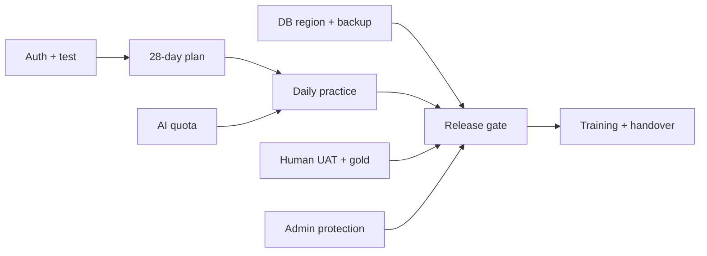

# ЛЗ 5 — WBS, capacity, RACI, релиз

Бұрынғы WBS және 5 package dictionary сақталған: [WBS](../plan/wbs.md), [dictionary](../plan/wbs-dictionary.md). Нәтиже деңгейлері: 1 өнім → 1.1 foundation /1.2 diagnostic /1.3 plan /1.4 practice /1.5 quality /1.6 handover → auth/test/history/day/chat/backup/training сияқты leaf deliverable. Әр leaf-тің Done белгісі working artifact, әрекет атауы емес.

08.11 қайта жоспарлау: [үш адамдық жарғы](project-charter.md). Бұрынғы 1 developer baseline тарихи. Ескі RACI-дегі жалғыз owner жаңа шешімге қолданылмайды.

| Нәтиже | Есқат PM | Расуул Dev | Диас QA/Ops |
|---|---|---|---|
| Requirements / business case | A/R | C | C |
| API/UI/AI implementation | C | A/R | C |
| Test/security/CI | C | R | A/R |
| Release/backup/restore | C | R | A/R |
| Scope/UAT/handover | A/R | C | R |

Әр жолда бір A. Human UAT-қа сыртқы ерікті consulted/acceptance participant; ойдан алынған орталық қол қойған жоқ.

| Инкремент | Мерзім (жоспар) | Scope | Өлшенетін exit |
|---|---|---|---|
| I 1 | 09–15.11 | auth, diagnostic, 28 күн; 36 h | tokenless 401, cross-user 404,28/84, history 2 attempts |
| I 2 | 16–22.11 | practice, progress, AIoff;37 h | provider сыз толық жол, invalid 400, no external call on opt-out |
| I 3 | 23.11–06.12 | quality/handover;37 h +14 assurance | tests/build, scanners, restore, UAT, readme |

| Сыртқы тәуелділік | Owner / керек күн | Trigger / contingency |
|---|---|---|
| AI quota/model | Расуул /16.11 | 429/404 → AIoff, deterministic practice |
| PostgreSQL hosting/backup аймағы | Диас /23.11 | аймақ дәлелі жоқ → тек localhost synthetic pilot |
| Repo admin branch protection | Диас /20.11 | admin=false → owner нұсқаулығы, merge қолмен gate |
| Әдіскер/оқытушы UAT және gold | Есқат /27.11 | қатысушы жоқ → no-go external pilot, internal demo |

Capacity арифметикасы:180−18−12=150 h; стандарт 15%reserve 22.5→127.5 h, scope 124 сыйғандай көрінеді. Бірақ ЛЗ 7 EMV 38.4 h +management 6=44.4 h; 124+44.4=168.4, **18.4 h тапшылық**. Екі резерв қосылып есептелмейді: risk-based 44.4 стандарт 22.5-ті алмастырады. Сондықтан қауіпі бар full scope-ты сол күнге міндеттеме ретінде қабылдамаймыз. Ұсынылған cut: I 2 advanced content 8 h + optional visualization 5 h + PM narrative enhancement 5.4 h=18.4, немесе +18.4 h capacity/мерзім. Security, core 28 күн, UAT қысқартылмайды. PM шешімі талап етіледі; барлық зертхана артефактілері қазір дайындалуы бұл болашақ жұмыстың нақты уақыт есебі емес.

Migration: schema diff/backup → isolated rehearsal → reconcile → release; destructive db push production-та автоматты орындалмайды. Training: 30 мин әдіскер flow, 15 мин оператор restore; қатысушы өз бетімен қайталайды. Handover: runbook, environment names (мәндері емес), issue list, reviewer, backup restore evidence. Нақты training әлі өткізілген жоқ.
